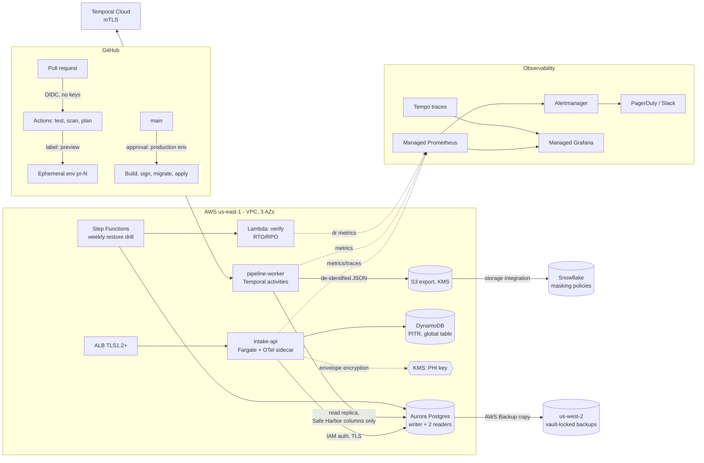
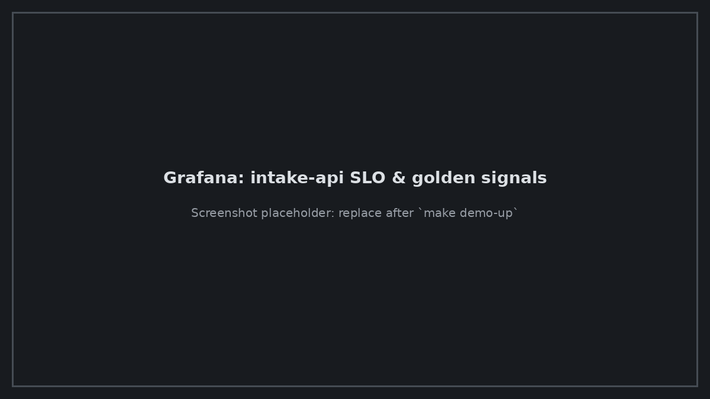
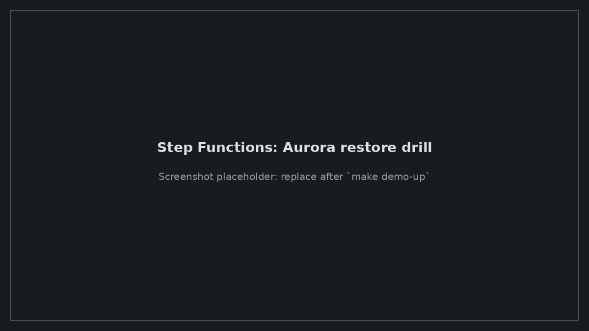
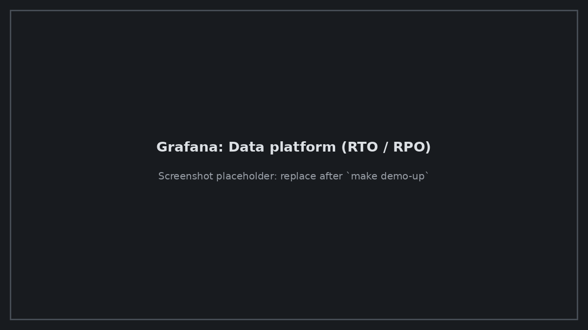
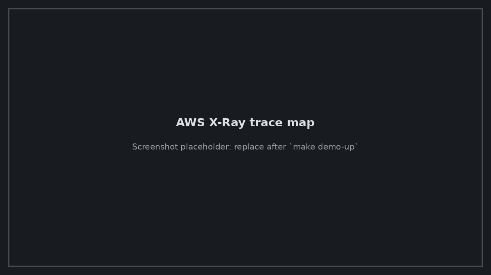

# Meridian Platform

**A HIPAA-ready, self-service AWS platform for a healthcare product team, built as code.**

Meridian is a reference platform for a (fictional) digital health company. It shows how I'd design, build, and operate the infrastructure a regulated product team runs on: paved-road Terraform modules, a highly available Postgres data tier with *proven* disaster recovery, a de-identified analytics pipeline into Snowflake orchestrated by Temporal, Prometheus + Grafana observability with SLOs and tested alerts, and keyless GitHub Actions CI/CD with per-PR preview environments.

Everything here is real, runnable code. The Python services and DR Lambda have test suites, and the Prometheus alert rules have `promtool` unit tests. A low-cost **demo environment** deploys the same modules to AWS so the platform can be shown running ([below](#deployed-proof-the-demo-environment)).

---

## Architecture



## How this maps to the role

| Responsibility | Where to look |
|---|---|
| **Secure, scalable IaC with reusable modules and paved roads** | [`terraform/modules/`](terraform/modules): `network`, `kms`, `aurora-postgres`, `dynamodb-table`, `ecs-fargate-service`, `db-admin-task`, `observability`, `dr-restore-drill`, `snowflake-analytics`. The same modules build both prod and a low-cost demo, with only the inputs changed. A product team gets a production-grade service from about 15 lines ([paved-road guide](docs/platform/paved-road.md)). |
| **Postgres / Aurora / Snowflake: HA, backups, DR, migrations** | Multi-AZ Aurora with IAM auth, pgaudit, PITR, and vault-locked cross-region AWS Backup ([module](terraform/modules/aurora-postgres/main.tf)). An automated **weekly restore drill** measures real RTO/RPO ([state machine](terraform/modules/dr-restore-drill/state-machine.asl.json)). Expand/contract Alembic migrations are tested up, down, and for ORM drift ([tests](services/intake-api/tests/test_migrations.py)). Snowflake has RBAC, masking policies, and a network policy ([module](terraform/modules/snowflake-analytics/main.tf)). |
| **Self-service developer platform: CI/CD, testing, local + ephemeral envs** | [`ci.yml`](.github/workflows/ci.yml) (tests, Terraform validate, tflint, Checkov, Trivy, gitleaks, plan-as-PR-comment). [`ephemeral-env.yml`](.github/workflows/ephemeral-env.yml) gives each PR a full stack with synthetic data, cleaned up by a TTL reaper. [`deploy.yml`](.github/workflows/deploy.yml) builds once, signs with cosign, runs migrations, applies Terraform, and passes an SLO gate. `make up` starts the whole stack locally. |
| **Observability standards** (Prometheus + Grafana) | Multi-window burn-rate SLO alerts, PHI security alerts, and DR alerts ([rules](observability/prometheus/rules)) with **promtool unit tests** ([tests](observability/prometheus/tests/alerts.test.yml)). Dashboards are generated from code ([generator](observability/grafana/build_dashboards.py)). The OTel sidecar on every service scrubs PHI from traces. The same rule files run locally and in Amazon Managed Prometheus. |
| **Engineering standards, review, mentorship** | [ADRs](docs/adr), [runbooks](docs/runbooks), [PR template](.github/pull_request_template.md) with a risk checklist, [CODEOWNERS](.github/CODEOWNERS), policy-as-code with justified exceptions ([`.checkov.yml`](.checkov.yml)). |
| **HIPAA / SOC 2: IAM, network security, PHI handling** | [Control mapping](docs/compliance/hipaa-soc2-controls.md). Field-level envelope encryption bound to row and column ([crypto.py](services/intake-api/src/intake_api/crypto.py)). Append-only audit log enforced by a DB trigger. Log redaction. Safe Harbor de-identification with an allow-listed schema ([deidentify.py](workflows/pipeline-worker/src/pipeline_worker/deidentify.py)). Isolated data subnets, VPC endpoints, and keyless OIDC CI ([bootstrap](terraform/bootstrap/github-oidc/main.tf)). |
| **AI-native development with validation and oversight** | [`CLAUDE.md`](CLAUDE.md) sets out what the agent may and may not do, which checks must pass, and which changes always need human review. [ADR-0005](docs/adr/0005-ai-assisted-development.md) covers it in more depth. |
| **Temporal workflow orchestration** | [`DeidentifyExportWorkflow`](workflows/pipeline-worker/src/pipeline_worker/workflow.py) is resumable, uses per-step retry policies, and calls `continue_as_new` for unbounded backfills. Raw PHI never enters workflow history. |
| **AWS Fargate, Lambda, Step Functions, DynamoDB** | All used where they fit: Fargate for services and workers, Step Functions plus Lambda for the DR drill, DynamoDB global table for idempotency keys. |

## Repository layout

```
terraform/
  modules/            reusable, opinionated building blocks (the paved road)
  envs/prod/          production composition (primary + DR region)
  envs/demo/          same modules, cost-minimized; deployed for evidence, then destroyed
  envs/ephemeral/     per-PR preview stacks (workspace per PR)
  bootstrap/          GitHub OIDC roles (keyless CI/CD)
services/intake-api/  FastAPI service: PHI intake, envelope encryption, audit log, Alembic migrations
workflows/pipeline-worker/  Temporal worker: Aurora -> Safe Harbor -> S3 -> Snowflake
lambdas/dr_verify/    restore-drill verification + RTO/RPO metrics
observability/        Prometheus rules + tests, Grafana dashboards-as-code, local stack configs
docs/                 ADRs, runbooks, compliance mapping, paved-road guide
.github/workflows/    CI, ephemeral envs, deploy, on-demand DR drill
```

## Quick start

```bash
make up          # Postgres, API, Temporal, Prometheus, Grafana, Tempo, Alertmanager
make seed        # 200 synthetic patients
open http://localhost:3000   # Grafana: "intake-api: SLO & golden signals"

make test        # every test suite + promtool rule tests + dashboard drift check
make tf-check    # terraform fmt + validate across all modules/envs
```

## Deployed proof: the demo environment

`envs/prod` is the design. `envs/demo` is what I actually deployed to AWS to show it working: the **same modules** with cost-minimizing inputs, brought up with one command and torn down afterwards ([guide](docs/demo.md)).

```bash
make demo-up BUDGET_EMAIL=you@example.com   # ~20 min, ~$0.10-0.30/hour while up
make demo-grafana                           # dashboards against Managed Prometheus
make demo-drill                             # live restore drill with measured RTO/RPO
make demo-down
```

<!-- After running the demo, save screenshots under docs/demo/ with these names. -->
| Grafana: SLO & golden signals | Restore drill (Step Functions) |
|---|---|
|  |  |
| **Data platform: measured RTO/RPO** | **X-Ray trace map** |
|  |  |

### Prod vs. demo: what changes and why

Every difference is a module **input**, not a fork. That is the paved road working as intended.

| Setting | prod | demo | Why the demo differs |
|---|---|---|---|
| Availability zones | 3 | 2 | Aurora's minimum. Still shows multi-AZ subnet design. |
| NAT gateways | 1 per AZ | 1 shared | ~$0.09/hr saved. Losing an AZ cuts egress, which is acceptable for a demo. |
| Interface VPC endpoints | 8 services × 3 AZs | none (S3/DynamoDB gateway endpoints only) | ~$0.24/hr saved. AWS API traffic goes through the NAT instead. |
| Aurora | writer + 2 readers, 0.5–32 ACU | 1 instance, **scales to zero** | Pays only while queried |
| Backups | PITR 35d + daily AWS Backup, 6-yr, cross-region, vault-locked | PITR 1d only | A vault lock can't be undone, so it doesn't belong in a throwaway account. The restore drill still runs. |
| Deletion protection | on | off | So `make demo-down` works |
| TLS at the ALB | ACM certificate, TLS 1.3 policy | plain HTTP, **deployer's IP only** | No domain needed. A precondition blocks this in prod. |
| Traces | Grafana Tempo | AWS X-Ray | Nothing to host |
| Grafana | Amazon Managed Grafana (SSO) | local Grafana → Managed Prometheus (SigV4) | Managed Grafana needs IAM Identity Center/Organizations |
| Snowflake + Temporal pipeline | deployed | runs locally (`make up`) | Avoids two more vendor accounts |
| Fargate | 3–20 tasks, 0.5 vCPU | 1–2 tasks, 0.25 vCPU | Size |
| Terraform state | S3 + native locking | local | Single operator, short-lived |
| **Approx. cost** | **~$0.75/hr (~$550/mo)** | **~$0.10–0.30/hr** | |

Unchanged in the demo: KMS key separation, field-level PHI encryption, IAM database auth, the separate db-admin task holding the master credential, the append-only audit log, isolated data subnets, flow logs, Prometheus rules and alerting, and the restore drill.

## Design decisions

- [ADR-0001](docs/adr/0001-field-level-encryption.md): Field-level envelope encryption on top of storage encryption
- [ADR-0002](docs/adr/0002-temporal-for-data-pipelines.md): Temporal for data pipelines instead of cron or Airflow
- [ADR-0003](docs/adr/0003-prometheus-grafana-observability.md): Prometheus + Grafana (managed) for observability
- [ADR-0004](docs/adr/0004-ephemeral-environments.md): Per-PR ephemeral environments with synthetic data
- [ADR-0005](docs/adr/0005-ai-assisted-development.md): AI-assisted development with explicit oversight boundaries

## Scope notes

This is a portfolio project. `envs/prod` is a complete design that hasn't been applied. `envs/demo` is the deployable subset ([guide](docs/demo.md)). `envs/dev` isn't included: it has the same composition as `prod` with dev-sized inputs, plus outputs that the ephemeral stacks read through remote state. Account IDs, ARNs, and `OWNER` placeholders need replacing before anything in `prod` is applied.

Verification: `make test` runs the Python suites, promtool rule tests, and the dashboard drift check. `make tf-wiring` checks every module call's inputs and outputs offline, and CI additionally runs `terraform validate`, tflint, and Checkov. The Temporal workflow test uses Temporal's time-skipping test server, which CI downloads automatically.
